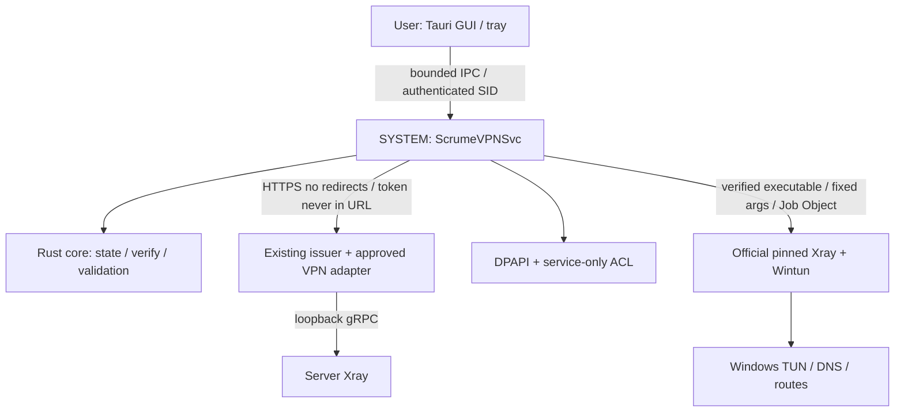

# Архитектура v2

SOURCE: Windows x64, branded one-button GUI, SYSTEM service, VLESS REALITY, server control, per-device enrollment. SOURCE D002–D005: pre-login autoconnect после initial auth, vault службы, policy override.

## Принципы

1. GUI передаёт email и OTP в защищённый pipe. HTTPS выполняет служба. Install token, UUID и signed bundle не возвращаются WebView. Password не нужен. Secret types не сериализуются в status, Debug редактируется.
2. До enrollment служба RUNNING, VPN UNENROLLED. После успешного enrollment service связывает owner SID с enrollment id, сохраняет token через DPAPI machine context и атомарную запись в service-only ACL directory. SCM startup использует vault без GUI.
3. Встроенные issuer URL и signing trust roots — installation configuration IT, не произвольные поля GUI и не server-driven endpoint. HTTPS с системной проверкой, no cross-host redirects, bounded responses/timeouts.
4. Один signed bundle = profile + policy + version + binding + lease. Сначала signature, strict parse, binding/time/rollback/schema, затем генерация config. Сохранение bundle и monotonic state атомарно ДО применения. Неуспешное применение не снижает high-water mark.
5. Xray owns native TUN, DNS и его routes. Service owns Job Object, lifetime, health, recovery journal собственных изменений. Connected только после real health evidence. Exit процесса не означает отсутствие остаточных сетевых изменений: это проверяется.
6. Disconnect отменяет pending connect; generation id не позволяет позднему healthcheck вернуть CONNECTED. Expiry/revoke во время подключения тоже отменяют операцию.
7. Служба один раз извлекает caller SID из impersonation/token, проверяет сессию и владельца на каждую команду. Перед filesystem/network операцией RevertToSelf. Reject remote pipe clients. Первичное назначение владельца требует явной модели bootstrap и проверки interactive session. Парсер сообщений сам по себе не предоставляет авторизацию.
8. Реконнект: single flight, jitter/backoff, max delay; сеть сменилась — переопределить physical interface, проверить bootstrapping, восстановить только собственные записи. Не удалять чужие VPN/WFP rules.
9. Отзыв на сервере имеет приоритет над локальным cache. Локальное удаление токена не равно server revoke. Sign out останавливает tunnel, очищает local vault; серверный отзыв — admin endpoint.
10. Локальный администратор/SYSTEM вне гарантии секретности. Machine DPAPI без ACL недостаточен. Логи доступны только service/admin; UI получает error codes и понятный текст без raw payload.

## Слои и состояние реализации

| Слой | Назначение | Приёмка |
|---|---|---|
| crates/scrume-core | signed envelope, typed bundle, validation, state, bounded IPC parser | macOS unit/contract tests |
| apps/service | SCM lifecycle; сейчас scaffold, без подключения | Windows compile отдельно от SCM E2E |
| apps/lab | offline vector verification и диагностика, без сети | deterministic tests |
| tools | doctor, test, verified runtime fetch, SBOM/license inventory | one-command local automation |
| apps/desktop | Tauri shell / tray / user lifecycle, будущий этап | UI + Windows integration |
| packaging | WiX enterprise install и recovery, будущий этап | clean VM install/upgrade/uninstall |

## Network POC — обязательный выход

Сделать baseline snapshot routes, DNS, interfaces и connectivity; разрешённый staging peer; start native TUN; показать egress для процесса без proxy settings; DNS IPv4/IPv6/UDP; endpoint loop prevention; disconnect; kill Xray; kill service; reboot; сравнить own changes и connectivity. Проверять при Wi-Fi↔Ethernet и чужом VPN. Никаких active network tests на хостовом Mac.

VMware Fusion на Apple Silicon выполняет ARM64 guest. Эмуляция x64 user-mode не доказывает x64 driver/service target. Допустимы ARM64 native test build и отдельные отчёты, но выпускной x64 стенд нужен дополнительно.
